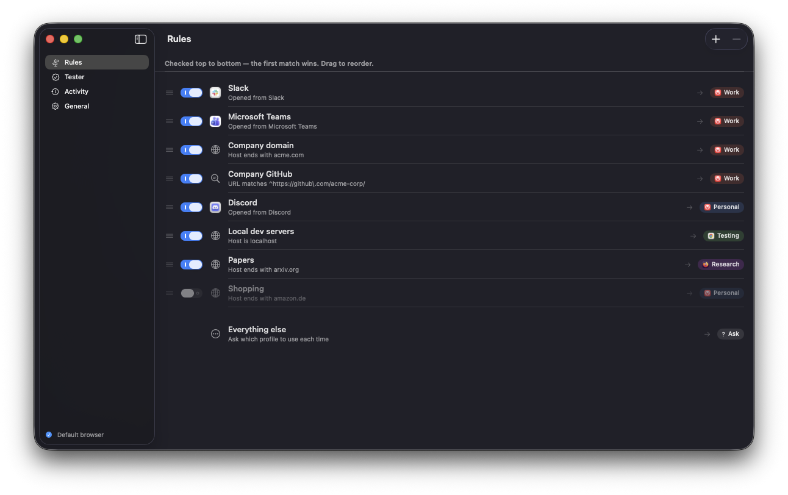

# bivietas

Native macOS link router for browser profiles.

bivietas registers as your default browser, catches every link you click in other apps, and opens it in the right browser profile. Work links go to the Work profile and everything else goes to Personal, based on rules you set.



## Features

- **Rules, first match wins.** Match on the exact host, a host suffix (subdomains included), a URL regex, or the app the link was clicked in.
- **Several browsers.** Vivaldi, Chrome, Brave, Edge, Chromium and Firefox profiles are picked up automatically.
- **Everything else.** Links that no rule matches open in a default profile, or bivietas asks with a picker that can remember your choice for that host.
- **Redirect unwrapping.** Rules match the real destination inside Outlook SafeLinks, Google and Slack redirects. You can add your own redirect wrappers.
- **Tester.** Paste a link to see which rule matches and where it would open, without opening it.
- **Activity.** Shows recent links with their rule and target, and lets you reopen one in another profile.
- **Menu bar only.** Pause routing, see recent links, open at login.

Safari isn't supported because it can't open a link in a given profile. Arc isn't supported because it ignores `--profile-directory`.

## Requirements

- macOS 15 or later
- Xcode 27 or later to build it

## Build

Open `bivietas.xcodeproj` in Xcode and run the `bivietas` scheme, or build it from the command line:

```sh
xcodebuild -project bivietas.xcodeproj -scheme bivietas -configuration Release build
```

The app isn't sandboxed, because launching a browser with command-line arguments doesn't work under the App Sandbox. Once it's running, open **Settings… → Make Default** to make bivietas your default browser.

The routing core has unit tests that run without Xcode:

```sh
swift test
```

## Configuration

Rules are stored in `~/Library/Application Support/bivietas/config.json`. The app watches this file and reloads it when you edit it by hand.
